# Desk Companion

A tiny ESP32 buddy that sits on your desk and reacts to what your PC is doing: Claude Code sessions,
the music or video you're playing, the game you launched, every `git push`.

<p align="center">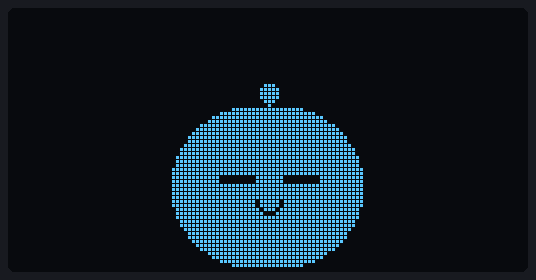</p>

The PC sends small JSON **events** over Wi-Fi; the companion turns them into an **expression** on its
128×64 two-colour OLED (yellow banner on top, blue face area below) and, sometimes, a short tune on its buzzer.

## Screens

Two characters live on the screen: **the Ball**, the round mascot with an antenna, for everything
everyday, and **the Mascot**, Claude Code's pixel-art critter, for everything Claude.

> The GIFs below are rendered from the real firmware drawing code (`compagnon/expressions.cpp` and
> `compagnon/etat.cpp`), fed with real events. Banner texts are the firmware's own, some in French.

### Everyday

| | | |
|:-:|:-:|:-:|
|  | 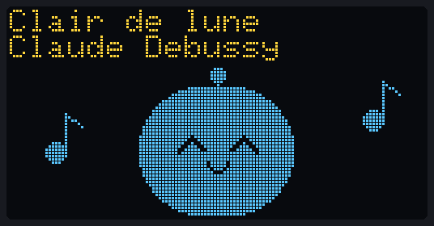 | 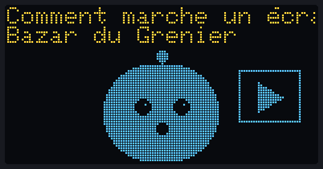 |
| **Idle**: smiles and blinks now and then. The banner only speaks up if Wi-Fi drops. | **Music**: dances between bouncing notes; title and artist scroll in the banner. | **Video**: wide-eyed, stares at a small screen with a ▶; title and channel scroll in the banner. |
| 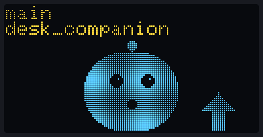 | 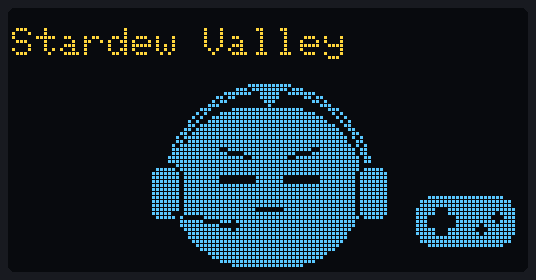 | 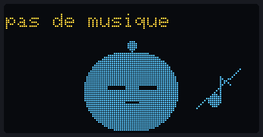 |
| **Git push**: looks up in awe as an arrow flies, with a victory fanfare. | **Gaming**: gamer headset on, focused frown, controller in hand. Replaces Idle while a Steam or Lutris game runs. | **Silence**: music button pressed while no track or video plays ("Silence radio"). |
| 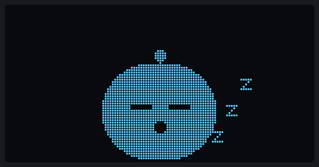 | | |
| **Asleep**: after 2 minutes with no event from any PC. Eyes closed, "z"s rising. The music button shows "Gros dodo temps". | | |

### Claude Code

| | | |
|:-:|:-:|:-:|
| 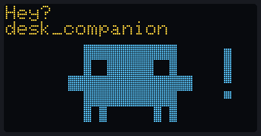 | 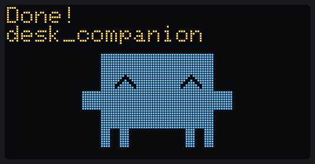 | 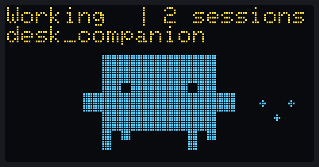 |
| **Waiting**: a session needs you (permission prompt). Waves until you answer, with a two-note chime. | **Done**: a session finished its turn. Happy hops and a short rising bell. | **Working**: shown by the Claude button, with the session count when several are open. |
| 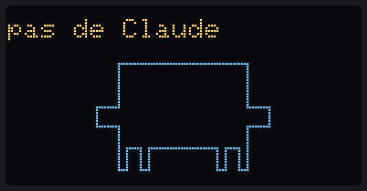 | | |
| **No Claude**: Claude button pressed with no known session. | | |

## How it behaves

- **Fallback screen**: when nothing else is showing, the companion returns to *Waiting* if a Claude
  session waits for you, otherwise *Gaming* if a game runs, otherwise *Idle*. After 2 minutes with no
  event at all, it falls asleep (eyes closed, rising "z"s) and *Asleep* replaces *Idle* until the next event.
- **Temporary screens** (Done, Music, Video, Push) show for a few seconds, then return to the fallback.
- **Two buttons** show a quick reminder on top of the current screen, silently: the **music button**
  shows the current track or video (or *Silence*), the **Claude button** shows the most urgent session
  (waiting > working > done, or *No Claude*).
- Up to **8 Claude sessions** are tracked in parallel; a session silent for 12 h is forgotten.
- Only one thing plays at a time: a new track replaces the current video and vice versa. The PC tells
  them apart by the address of what plays (YouTube, Twitch, Netflix…, or a local video file → video;
  anything else, YouTube Music included → music).
- Music, video and game state are re-sent by the PC every 10 s and forgotten after 30 s without news.

The full domain vocabulary and rules live in [`GLOSSARY.md`](GLOSSARY.md) (French).

## Hardware

| Part | Connection |
|---|---|
| ESP32 dev board | — |
| SSD1306 OLED 128×64, yellow/blue, I²C (`0x3C`) | SDA → GPIO 21, SCL → GPIO 22 |
| Passive buzzer | GPIO 18 |
| 10 kΩ potentiometer (volume) | ends → 3V3 and GND (never 5 V), wiper → GPIO 34 |
| Music button | GPIO 27 ↔ GND (internal pull-up) |
| Claude button | GPIO 26 ↔ GND (internal pull-up) |

`outils/scan_i2c` and `outils/test_affichage` help check the wiring and the screen.

## Firmware

Requires the ESP32 Arduino core **3.x** and the libraries *Adafruit GFX*, *Adafruit SSD1306* and *ArduinoJson*.

```sh
cp compagnon/secrets.example.h compagnon/secrets.h   # then fill in your Wi-Fi SSID and password
arduino-cli compile --fqbn esp32:esp32:esp32 compagnon
arduino-cli upload  --fqbn esp32:esp32:esp32 -p /dev/ttyUSB0 compagnon
```

Once connected, the companion answers at `http://compagnon.local` (mDNS).

## Sending events

One route, `POST /event`, with a JSON body: `type`, an optional `text` (a `\n` splits the banner into two
lines), plus `artist` for music and video (the channel) and `session` for Claude events.

```sh
curl -X POST -H 'Content-Type: application/json' \
  -d '{"type":"git_push","text":"main\nmy-project"}' http://compagnon.local/event
```

| Type | Screen | Sound |
|---|---|---|
| `claude_waiting` | Waiting | chime |
| `claude_done` | Done | bell |
| `claude_working`, `claude_end` | updates session state | — |
| `music` / `music_stop` | Music / stops the track or video | — |
| `video` | Video (same fields as `music`: `text` = title, `artist` = channel); replaces the current track | — |
| `game` / `game_stop` | Gaming as fallback / back to Idle | — |
| `git_push` | Push | fanfare |

## PC side

Ready-made senders live in [`hooks/`](hooks/README.md) (Linux; need `jq` and `curl`; target overridable with `COMPAGNON_URL`):

- `compagnon-hook.sh`: Claude Code hooks (`Stop`, `Notification`, `SessionEnd`…), see `settings-extrait.json`.
- `compagnon-push.sh`: a global git `reference-transaction` hook that fires on every successful push.
- `compagnon-musique.sh`: follows `playerctl` and sends `music` or `video`, run as a systemd user service.
- `compagnon-jeu.sh`: detects Steam (native or Proton) and Lutris games, run as a systemd user service.

Installation steps are detailed in [`hooks/README.md`](hooks/README.md) (French).

## Tests

```sh
make test
```

Runs the state-logic unit tests on the PC (`g++`, no Arduino needed) and the shell tests of every hook.
